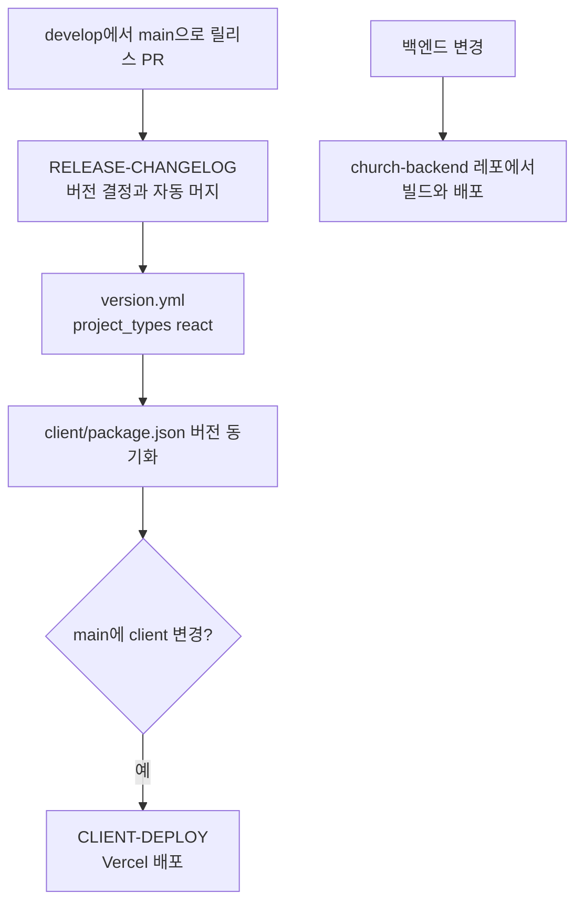

<!-- projectops:report -->
## 개요

백엔드가 여러 교회가 함께 쓰는 공용 서버(church-template/church-backend#86)로 옮겨 갔습니다. 그래서 이 레포에 남아 있던 예전 구조의 `server/` 폴더, `SERVER-CI`·`SERVER-DEPLOY` 워크플로, 백엔드 전용 규칙을 지웠습니다. 이제 이 레포는 프론트엔드(`client/`)만 둡니다. 버전도 `client/package.json` 하나로 관리합니다.

## 기능 흐름

## 변경 사항

| 파일 | 내용 |
|---|---|
| `server/` | 폴더 삭제(Spring Boot 백엔드 전체) |
| `.github/workflows/SERVER-CI.yaml`, `SERVER-DEPLOY.yaml` | 삭제 |
| `.claude/rules/` | `paths: server/**` 규칙 6개 삭제(api-conventions, media-library, multi-church-template, persistence-conventions, rbac-authorization, spring-boot-4) |
| `version.yml` | `project_types`를 `["spring","react"]` → `["react"]`, `project_paths`의 spring 줄 제거 |
| `README.md` | 백엔드 배지·폴더 행·로컬 기동·서버 시크릿 설명 제거, "백엔드는 공용(church-backend)" 안내와 새 교회 등록 절차 링크로 교체, 서버 배포를 그린 다이어그램 2개(release-flow, new-church) 삽입 제거 |
| `CLAUDE.md`, `client/README.md`, `.claude/rules/versioning-ci.md` | 서버 설명을 church-backend 기준으로 교체 |
| `docs/채워넣어야하는값.md` | 9장을 `server/.env` 값 → 공용 서버 등록 스크립트 입력값(대표자 이름·번호·프론트 주소)으로 교체 |

## 수정 전후 화면

화면 변경이 없는 작업이라 생략합니다.

## 주요 구현 내용

- **지워도 되는 근거**: 템플릿 레포에서는 `SERVER-DEPLOY`가 원래 건너뛰어지도록 설정돼 있었고, 이 템플릿으로 만든 새누리교회도 서버 정보(`DEPLOY_HOST`)가 없어 실제 서버 배포는 한 번도 하지 않았습니다. 백엔드 운영은 이미 church-backend 하나로 돌고 있습니다.
- **버전 primary 변경**: 기존에는 primary가 spring(`server/build.gradle`)이라 폴더만 지우면 버전 동기화가 깨집니다. `project_types`를 react 하나로 바꿨고, 로컬에서 `version_manager.sh get`(0.4.0 읽음)과 `increment`(0.4.0 → 0.4.1, `client/package.json`까지 반영)를 실행해 확인한 뒤 되돌렸습니다.
- **projectops 공용 파일은 그대로**: `PROJECT-COMMON-*` 워크플로와 `.github/scripts/*`에도 spring·gradle 분기가 있지만 여러 타입을 지원하는 공용 코드라 손대지 않았습니다.

## 주의사항

- **다이어그램 파일은 남아 있습니다**: `docs/diagrams/release-flow-*`, `new-church-*`는 서버 배포 흐름을 그리고 있어 README에서 빼기만 했습니다. 다시 그리거나 지우는 건 별도 작업입니다. `runtime-*`(Next.js → Caddy → Spring Boot API)은 공용 서버에서도 맞는 그림이라 그대로 둡니다.
- **`version.yml` 주석의 "project_types는 최초 설정 후 변경하지 마세요"**: 이번에 바꿨습니다. 버전 값은 `client/package.json`과 같아서 문제없고, 다음 릴리스 PR에서 버전이 정상으로 오르는지 한 번 더 확인이 필요합니다.
- **API 계약 파일**: `client/docs/api-docs.json`은 이제 church-backend OpenAPI의 사본입니다. 백엔드 계약이 바뀌면 이 파일을 따로 갱신해야 합니다.
