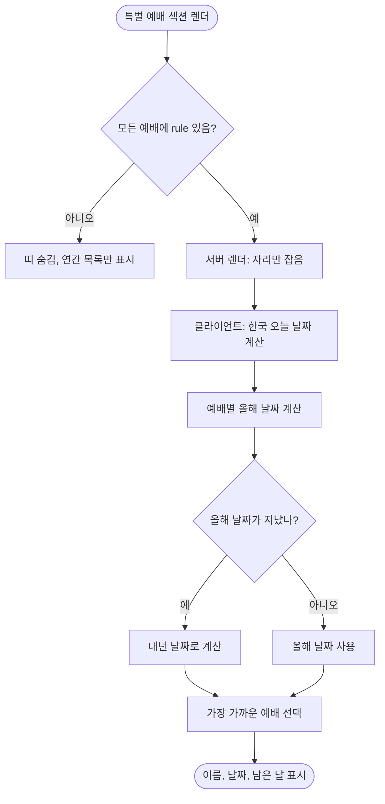

<!-- projectops:report -->
# 정보 컨테이너 카드를 줄 목록으로 통일

## 개요
글만 있는 정보 항목(특별 예배·찾아오는 방법·챌린지 목록·일정 모바일 목록)을 박스 카드로 감싸서, 주변의 줄 목록 섹션과 결이 끊기고 강조가 흩어지던 문제를 고쳤습니다. 4개 화면을 모두 **2px 검정 룰 + 헤어라인 줄 목록**으로 통일하고, "다음 특별 예배"처럼 방문자가 실제로 묻는 정보(다음은 언제?)를 한 곳에만 강조했습니다.
시안 4안 중 고른 안: 특별 예배 **C(다음 예배 띠 + 연간 목록)**, 찾아오는 방법 **B(아이콘 줄 목록)**, 챌린지 **B(줄 목록)**, 일정 **C(날짜 칸 고정 아젠다)**.

## 기능 흐름
"다음 특별 예배" 띠는 상수의 날짜 규칙(`rule`)으로 오늘(한국 날짜) 기준 가장 가까운 예배를 계산합니다.

## 변경 사항

### 특별 예배 (`/worship`)
- `client/src/components/worship/WorshipSpecial.tsx`: EventCard 3열 그리드를 연간 줄 목록(시기 | 이름·설명 | 시간)으로 교체. 위 주중 예배 표와 같은 결
- `client/src/components/worship/SpecialNextBand.tsx` (신규): "다음 특별 예배" 띠. `NextServiceBand`와 같은 `useSyncExternalStore` 구독
- `client/src/lib/specialService.ts` (신규): 날짜 규칙(`fixed`·`nthSunday`·`lastSunday`·`easter`)과 `nextSpecial`·`formatDaysLeft`
- `client/src/constants/content.ts`: `SpecialService.rule` 추가, `specialNextLabel` 추가

### 찾아오는 방법 (`/about/location`)
- `client/src/components/about/LocationDirections.tsx`: 카드 스택을 아이콘 줄 목록으로. 이 밴드의 흰 박스는 문의 카드 하나만 남음

### 챌린지 목록 (`/challenges`)
- `client/src/components/challenges/ChallengeList.tsx`: 2열 카드를 줄 목록으로. 기간 | 상태 배지·제목·범위 | 하루 N장, 행 전체가 상세 링크

### 일정 모바일 목록 (`/events`)
- `client/src/components/events/EventCalendar.tsx`: EventCard 스택을 아젠다형으로. 왼쪽 날짜 칸(오늘은 데스크톱 달력과 같은 동그라미), 오른쪽에 일정 줄

### 문서
- `.claude/rules/DESIGN.md`: `special-worship-rows`·`directions-rows`·`challenge-rows`·`events-agenda` 항목 추가

## 수정 전후 화면
> 템플릿 레포 화면은 따로 띄우지 않고 **은샘교회 화면(동일 코드·동일 특별 예배 데이터)** 으로 대신합니다.

| 화면 | Before | After |
|---|---|---|
| 특별 예배 |  |  |
| 찾아오는 방법 |  |  |
| 일정 (모바일) |  |  |

챌린지 목록은 로그인(권한)이 필요해 화면 캡처 없이 단위 테스트로만 확인했습니다. 화면은 영상 대신 스크린샷입니다 (레이아웃만 바뀌고 동작 연출은 그대로).

## 주요 구현 내용
- **날짜 규칙은 문구와 분리**: 상수의 "5월 셋째 주일" 같은 표기는 사람이 읽는 문구라 그대로 두고, 계산은 별도 `rule`로만 합니다. 한국 날짜 기준이라 서버·기기 시간대와 무관합니다 (`kstCivilFromDate` 재사용).
- **틀린 "다음 예배"를 보이지 않기**: 규칙이 빠진 예배가 하나라도 있으면 `nextSpecial`이 null을 돌려 띠째 숨깁니다. 그 예배가 실제로 더 가까울 수 있어서입니다.
- **서버 렌더 레이아웃 밀림 방지**: 띠는 서버에서 자리만 잡고(`min-h`) 값은 클라이언트에서 채웁니다.
- **일정 아젠다 접근성**: 날짜 칸의 제목(`h3`)은 시각적으로 큰 숫자지만 스크린리더에는 "11월 15일 (일)" 전체를 읽히게 `sr-only`로 두었습니다.
- **일정 행 포커스 링**: 같은 날 일정 사이 구분선이 둥글게 휘지 않게 `ring-inset` + 직각으로 했습니다.

## 주의사항
- `EventCard`는 이제 `showcase` 페이지에서만 쓰입니다 (삭제하지 않음).
- 부활절 계산은 서방(그레고리력) 교회력 기준입니다.
- 전체 테스트에는 이 작업과 무관한 기존 실패가 있습니다(localStorage 환경 문제). 변경 전 기준선과 실패 목록이 동일함을 확인했습니다. 변경한 화면 관련 테스트 47개는 모두 통과합니다.
- 날짜 규칙이 실제 교회 일정과 다르면 `content.ts`의 `rule`만 고치면 됩니다.
