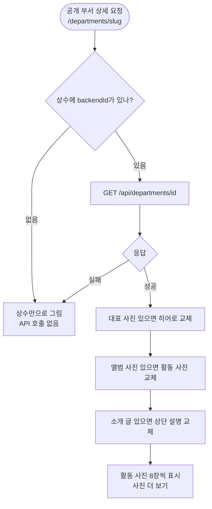

<!-- projectops:report -->
# ⚙️[기능추가][부서] 부서 대표 사진·활동 앨범 관리와 공개 페이지 반영

## 개요

관리 화면에서 부서에 대표 사진과 활동 사진 앨범을 연결할 수 있게 했습니다. 공개 부서 상세는 백엔드 부서와 연결된 경우 그 사진과 소개 글을 상수 대신 씁니다. 은샘교회 church-template/eunsaem-frontend `bff5d2e`(사진·앨범 기반)과 `70d3565`(활동 사진 8장씩 더 보기)를 옮겼습니다. 다음 이슈 #33(부서 수정 페이지)의 기반입니다. 백엔드 변경은 없습니다. (PR #35)

## 수정 전후

| 수정 전 (`develop` `edad6d7`) | 수정 후 (이 이슈 브랜치) |
|---|---|
|  |  |

- 부서 관리 → 학생부 `수정` 창을 위에서 아래로 넘긴 화면입니다. 수정 후에는 `대표 사진`(사진 고르기)과 `활동 사진 앨범` 칸, 공개 범위 안내가 생겼습니다
- 백엔드 응답은 브라우저 안에서만 가짜로 붙였습니다(운영 서버 요청 0건)

## 기능 흐름

## 변경 사항

### 관리
- `client/src/components/admin/departments/DepartmentFormDialog.tsx`(+test), `schema.ts`(+test): 대표 사진(미디어 선택)·활동 사진 앨범 칸, 요청 본문에 `heroMediaId`·`albumId`
- `client/src/components/admin/MediaPicker.tsx`, `media/MediaLibrary.tsx`, 갤러리 컴포넌트 9개: 서명 주소(`url`)를 쓰는 이미지 표시
- `client/src/lib/api/{departments,departments.admin,gallery,media.admin,types}.ts`, `client/docs/api-docs.json`: 부서 사진·앨범 칸이 들어간 API 명세와 타입

### 공개 부서 상세
- `client/src/app/departments/[slug]/page.tsx`(+test): `getDepartmentOverrides(dept)`로 대표 사진·활동 사진·소개 글을 덮어씀, 권한이 있으면 `수정` 진입(`DeptEditAction`)
- `client/src/constants/departments.ts`: `backendId?: number` 필드(예시 부서는 비워 둠)
- `client/src/components/departments/DeptGallery.tsx`(+test): 8장씩 보이고 "사진 더 보기"로 8장씩 더 엶, 라이트박스는 전체

### 공용
- `client/src/lib/mediaUrl.ts`(+test, 신규): `media:{id}` 주소와 서명 주소 처리
- `client/src/lib/markdown.ts`(+test), `components/common/MarkdownContent.tsx`: 본문 이미지 주소 처리
- `.claude/rules/DESIGN.md`: `dept-gallery` 항목

## 주요 구현 내용

- **템플릿 예시 부서에는 `backendId`를 넣지 않았습니다.** 부서 번호는 교회마다 관리 화면에서 만든 값이라 템플릿이 알 수 없습니다. 비어 있으면 공개 상세는 지금처럼 상수만으로 그려지고 API도 부르지 않습니다. 상수 주석에 "관리 화면에서 부서를 만든 뒤 그 id를 채운다"는 안내를 남겼습니다.
- **API 장애는 공개 페이지를 깨지 않습니다.** 부서 상세 조회가 실패하면 빈 덮어쓰기를 돌려주고 상수를 씁니다. 공개 페이지는 정적 생성 대상이라, 빌드 중 백엔드가 없을 때도 같은 경로로 처리됩니다.
- **소개 글은 상단 설명 자리를 덮어씁니다.** 은샘은 소개 문단(`intro.lead`) 자리를 바꾸지만, 템플릿은 상단에 상수 `description`(마크다운)을 보이는 구조라 그 자리에 API 소개 글을 넣었습니다.
- **은샘과 같은 파일은 그대로 가져왔습니다.** 은샘 변경 전 파일과 템플릿 파일을 하나씩 비교해 같았던 37개는 은샘 커밋 시점 파일을 복사했습니다. 부서 상세 페이지·`DeptGallery`·상수만 손으로 합쳤습니다.
- **마크다운 이미지 주소 수정도 함께 들어왔습니다.** 템플릿 `markdown.ts`에는 은샘의 API 주소 접두 수정이 빠져 있었습니다. 처음에는 템플릿 고유 변경으로 짐작했지만, 비교해 보니 은샘 쪽이 앞선 버전이라 은샘 파일로 맞췄습니다.

## 검증

- 부서 상세 테스트 3건 추가(`backendId` 없음 → 호출 없음 / API 값 반영 / API 실패 시 상수 유지). 구현 전에 실패하는 것을 확인했습니다
- 옮긴 테스트를 포함한 관련 묶음 통과. 전체 `pnpm test`의 실패 109건(17개 파일)은 `develop` 기준선과 같은 파일입니다(Node 26 + jsdom `localStorage`)
- `pnpm lint` 오류 0, `src/` 타입 오류 0, `pnpm build` 성공
- 실제 화면: 위 수정 전후 캡처(관리 수정 창). 공개 상세가 API 사진으로 바뀌는 부분은 서버에서 그리는 화면이라 브라우저 가짜 응답으로 바꿀 수 없어 단위 테스트로만 확인했습니다

## 주의사항

- **API 주소 없이 빌드하면 실패합니다.** `NEXT_PUBLIC_API_BASE`가 비어 있으면 `rss.xml`·`sitemap.xml`이 60초 제한에 걸려 `pnpm build`가 실패합니다. 이 PR과는 무관하고, 주소를 넣으면 통과합니다.
- 공개 상세의 `수정` 버튼과 API 덮어쓰기는 각 교회가 `backendId`를 채워야 동작합니다.
- 관리 수정 창은 #33에서 전용 페이지로 바뀝니다. PR #35가 머지되지 않아 이슈는 열어 둡니다.
