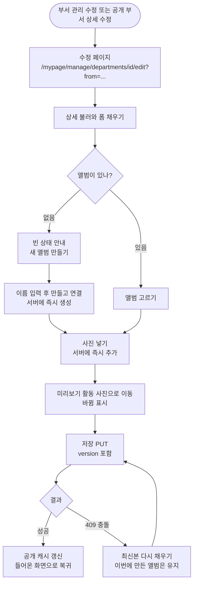

<!-- projectops:report -->
# 🚀[기능개선][관리] 수정 화면을 페이지와 미리보기로 통일, 앨범 바로 만들기

## 개요

부서 등록·수정을 32rem 모달에서 전용 페이지로 옮기고, 은샘교회에서 만든 관리 수정 화면의 공통 틀(왼쪽 입력, 오른쪽 미리보기, 아래 고정 저장 막대)을 가져왔습니다. 활동 사진 앨범은 갤러리로 가지 않고 그 자리에서 만들어 연결하고, 사진도 그 자리에서 넣습니다. 은샘교회 church-template/eunsaem-frontend#191(계획 1)을 옮긴 작업이며, #32(PR #35) 위에 쌓았습니다. 백엔드 변경은 없습니다. (PR #36)

## 수정 전후

| 수정 전 (`develop` `edad6d7`, 모달) | 수정 후 (이 이슈 브랜치, 페이지 + 미리보기) |
|---|---|
|  |  |

| 폰: 입력 | 폰: 미리보기 시트 |
|---|---|
|  |  |

- 부서 관리 → 학생부 `수정`으로 들어가는 같은 경로로 찍었습니다. 수정 후 흐름은 `새 앨범 만들기` → 만들고 연결 → `사진 넣기`로 5장 → 미리보기 활동 사진에 `바뀜` 표시 순서입니다
- 수정 전은 #32가 아니라 `develop`에서 찍었습니다. 두 이슈 모두 아직 머지 전이라, 마지막으로 공유된 화면을 기준으로 삼았습니다
- 템플릿 예시 부서에는 `backendId`가 없습니다. 미리보기를 보여 주려고 캡처하는 동안만 학생부를 7번에 연결했다가 되돌렸습니다
- 백엔드 응답은 브라우저 안에서만 가짜로 붙였습니다. 사진은 저장소에 있는 예시 부서 사진이고, 운영 서버 요청은 0건입니다

## 기능 흐름

## 변경 사항

### 공통 틀 (`client/src/components/admin/editor/`)
- `EditPageShell.tsx`: 머리(돌아가기 + 제목), 입력 7 : 미리보기 5, 아래 고정 저장 막대(상태 문구 · 취소 · 저장). 64rem 미만은 `미리보기` 버튼으로 아래 시트
- `useFitAbove.ts`: 미리보기 칸 높이를 "칸 윗변 ~ 저장 막대 윗변"으로 맞춤
- `Field.tsx`·`FormSection.tsx`·`ChangedBadge.tsx`: 칸(필수/선택 표기, 설명은 입력칸 아래), 구역 제목, `바뀜` 배지
- `client/src/components/ui/sheet.tsx`(아래 시트), `Input.tsx`·`Textarea.tsx`(기본 테두리 `hairline` → `muted-soft`, 설명 id와 오류 id를 함께 `aria-describedby`에)

### 부서 수정 (`client/src/components/admin/departments/`)
- `DepartmentEditForm.tsx`, `departmentForm.ts`: 옛 수정 창의 저장 규칙(상세 시드 · 낙관락 version · 409 재조회)을 페이지 폼으로 옮김
- `DeptAlbumField.tsx`: 빈 상태 안내, 새 앨범 만들기 창, 연결 카드(썸네일 · 장수 · 사진 넣기 · 앨범 열기). 만들기·사진 넣기는 `GALLERY_WRITE`가 있을 때만
- `DeptEditPreview.tsx`: 공개 부서 상세가 API로 바꾸는 구역(대표 사진 · 소개 · 활동 사진)만 그림
- `DepartmentManager.tsx`: 새 부서 · ＋하위 · 수정이 페이지로 이동

### 라우트 · 기타
- `client/src/app/(site)/mypage/manage/departments/new/page.tsx`, `[id]/edit/page.tsx`: 새 부서(`?parentId=`) · 수정 페이지, 잘못된 id는 404
- `client/src/lib/admin/returnPath.ts`: 돌아갈 주소(`?from=`)는 같은 사이트 경로만 허용
- `client/src/constants/departments.ts`: `findDepartmentByBackendId`, 공개 부서 상세의 `수정`에 `slug` 전달
- `.claude/rules/DESIGN.md`: `edit-page-shell`·`form-section`·`form-field`·`changed-badge`·`dept-album-field`·`dept-edit-preview`, `text-input` 테두리

## 주요 구현 내용

- **미리보기는 템플릿 공개 상세의 규칙을 따릅니다(은샘과 두 곳이 다름).**
  - 소개가 비면 상수 `description`을 보입니다. 은샘은 `intro.lead`를 쓰지만, 템플릿 공개 상세는 상단에 `description`을 보입니다.
  - 앨범 사진이 없으면 공개 상세처럼 상수 기본 사진을 보이고, "앨범을 연결하지 않아 기본 사진이 보입니다." 또는 "앨범에 사진이 없어 기본 사진이 보입니다. 사진을 넣으면 바뀝니다."라고 적습니다. 은샘은 이 경우 구역을 숨깁니다. 격자도 템플릿 공개 갤러리와 같은 정사각 4열입니다.
  - 미리보기가 공개 화면과 다르면 "바뀐 게 없는데 바뀐 것처럼" 보이기 때문에, 공개 상세가 실제로 쓰는 규칙만 따랐습니다.
- **부서명·담당은 미리보기에 넣지 않습니다.** 공개 상세가 이 값을 API가 아니라 상수에서 읽기 때문에, 미리보기에 띄우면 실제로는 안 바뀌는 값이 바뀐 것처럼 보입니다. 기본 정보 구역에 "공개 소개 페이지에는 나오지 않고 부서 관리 목록에 쓰입니다"라고 알립니다.
- **새 앨범 창은 `<form>`을 쓰지 않습니다.** 부서 `<form>` 안에 있는 컴포넌트라, 포털로 떠 있어도 React submit 이벤트가 부서 폼까지 올라가 부서 저장이 같이 실행됩니다. Enter는 직접 처리하고, 한글 조합 중 Enter(`isComposing`)는 무시합니다.
- **409 충돌 뒤에도 방금 만든 앨범을 유지합니다.** 앨범은 즉시 서버에 만들어지지만, 부서와의 연결은 저장할 때 반영됩니다. 최신본을 다시 채우면 연결이 풀려 앨범이 고아가 되므로, 이번에 만든 앨범 id를 기억했다가 다시 넣습니다.
- **돌아갈 주소는 URL 파서로 검사합니다.** 출처를 비교하고, 탭·줄바꿈(`/\t/host`)과 점 경로 정규화(`/a/..//host`)로 다른 사이트로 나가는 경우도 막습니다.
- **테스트에서만 학생부를 7번에 연결합니다.** 은샘 테스트는 "7번 = 학생부" 상수에 기대지만 템플릿 예시 부서에는 번호가 없습니다. 상수를 바꾸지 않고, 테스트 안에서 조회 함수만 목으로 연결했습니다. 조회 함수 자체는 목록을 넘기는 테스트로 따로 확인합니다.

## 검증

- 가져온 테스트로 먼저 실패를 확인한 뒤 구현을 넣어 통과시켰습니다. 미리보기 테스트는 템플릿 규칙(상수 소개 · 기본 사진 안내)으로 바꿔 실패 → 통과를 확인했습니다
- 부서 관련 88건 통과. 전체 `pnpm test`의 실패 109건(17개 파일)은 `develop` 기준선과 같은 파일입니다(Node 26 + jsdom `localStorage`)
- `pnpm lint` 오류 0(경고 4건은 이 이슈와 무관한 기존 파일), `src/` 타입 오류 0, `pnpm build` 성공(새 라우트 2개)
- 실제 화면(가짜 백엔드, 운영 요청 0건):
  - 공개 학생부 `수정` → 수정 페이지 → 새 앨범(기본 이름 "학생부 활동 사진") → 사진 5장 → 미리보기 4장 + "사진 5장" 안내 + `바뀜`
  - 저장 시 `albumId: 50, version: 3`이 실린 PUT 후 `/departments/student`로 복귀
  - 1440 / 820 / 390 폭에서 가로 넘침 없음. 820·390은 미리보기 칸 대신 시트로 열림

## 주의사항

- **예시 부서는 아직 공개 페이지와 연결돼 있지 않습니다.** `backendId`가 비어 있어서, 각 교회가 값을 채우기 전에는 공개 상세에 `수정`이 없고 미리보기는 "이 부서는 공개 소개 페이지가 없습니다."만 보입니다. 수정은 부서 관리에서 할 수 있습니다.
- **앨범 만들기·사진 넣기는 즉시 반영됩니다.** 부서 수정을 취소해도 만든 앨범은 남습니다(창에 안내 문구가 있음).
- **입력칸 테두리 변경은 사이트 전체에 적용됩니다**(로그인·가입·문의 폼 포함).
- 옛 `DepartmentFormDialog.tsx`와 그 테스트는 더 이상 쓰이지 않지만, 삭제 허락 전이라 남겨 두었습니다.
- **머지 순서**: PR #36의 base는 #32 브랜치입니다. #35를 먼저 머지한 뒤 #36의 base를 `develop`으로 바꿔야 합니다. 머지 전이라 이슈는 열어 둡니다.
- 은샘 #191의 계획 2(설교·공지·일정·주보·앨범·챌린지 폼 전환)는 아직 옮기지 않았습니다.
